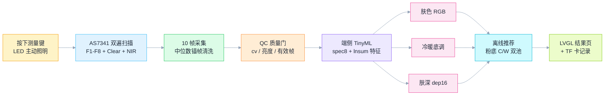
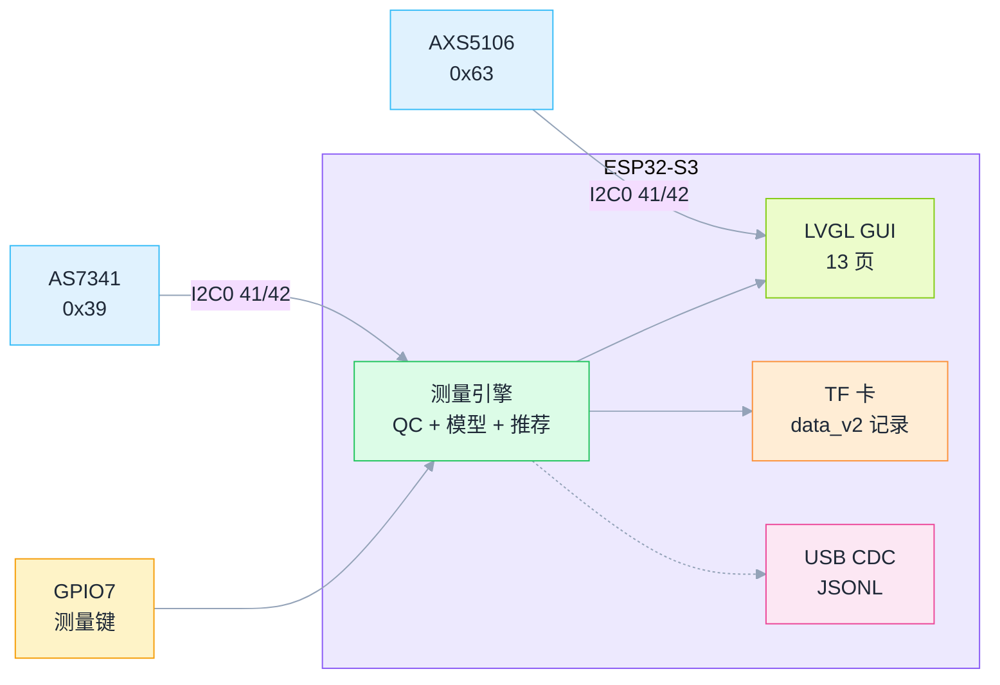
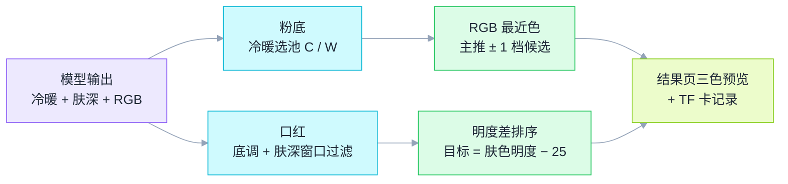

# SkinPen — 端侧光谱皮肤检测笔

<p align="center">
  <b>11-Channel Spectral Sensing · On-Device TinyML · Offline Beauty Recommendation</b><br>
  一支会"看"肤色的笔：不到 2 秒测出你的肤色光谱，离线推荐最适合你的粉底与口红。
</p>

<p align="center">
  
  
  
  
  
</p>

> **SkinPen** = 一支基于 **AS7341 十一通道光谱传感器 + ESP32-S3** 的皮肤检测笔：按下按键 ≈1.5 秒完成光谱采集 → 端侧 305 参数 TinyML 模型直接输出 **肤色 RGB / 冷暖底调 / 肤深等级** → 离线推荐引擎给出 **欧莱雅 True Match 粉底色号 + 口红色号**，全程不联网、数据只存在本地 TF 卡。

---

## 0. 一句话介绍

**SkinPen** 用 **真实光谱（而非摄像头拍照）** 测量皮肤，在 MCU 上跑多任务 TinyML 模型，把 8 通道可见光反射率翻译成「肤色 + 冷暖 + 肤深」三件套，再映射到 139 张 Pantone SkinTone™ 色卡与欧莱雅产品库——不是又一个"拍照猜色号"的 App，而是一台可以复现、可解释、完全离线的掌上测肤仪。

与普通肤色方案的区别：

| | 摄像头拍照比色 | SkinPen |
|---|---|---|
| 数据来源 | RGB 图像（受环境光/白平衡干扰） | **11 通道光谱反射率**（自带 LED 主动照明，封闭光路） |
| 推理位置 | 云端 / 手机 | **MCU 端侧**（305 参数，双精度累加，无浮点协处理器依赖） |
| 隐私 | 图像上传风险 | **物理离线**：固件无任何联网代码，数据只落 TF 卡 |
| 输出 | 一个近似色号 | 肤色 RGB + **冷暖底调 + 连续肤深** + 粉底/口红推荐 + 光谱曲线 |

---

## 1. 核心能力

| 能力 | 实现 |
|---|---|
| **光谱采集** | AS7341 SMUX 双表两遍扫描：F1–F4（415–515nm）+ F5–F8/Clear/NIR（545–910nm） |
| **主动照明** | 板载 LED 寄存器直驱 8mA，亮 30ms 定时积分，消除环境光干扰 |
| **帧级质量控制** | 每次测量 10 帧，中位数锚帧清洗（rdist>0.10 剔除）+ QC 三条（亮度/一致性/有效帧） |
| **端侧 TinyML** | 9→20→5 多任务 MLP（305 参数）：直出 RGB + 冷暖 + 肤深，纯 C 双精度推理 |
| **离线推荐** | 冷暖→欧莱雅 True Match C/W 双池 18 档粉底；明度差→18 支口红候选排序 |
| **数据记录** | TF 卡按日分目录 TXT 记录（时序续接）+ USB CDC 实时 JSONL 流 |
| **13 页 GUI** | LVGL 中文界面：测量/结果/历史/光谱曲线/色卡库，物理按键 + 触摸双交互 |
| **降级容错** | 传感器未接自动进 SIM 模式（标记 SIM-DEMO），不阻塞整机演示 |

---

## 2. 端到端链路



> 关键设计：模型一次前向同时输出 5 个值（RGB 3 + 冷暖 1 + 肤深 1），推荐引擎直接消费模型的冷暖/肤深输出——**感知与推荐天然同构**，无需二次规则推断。

---

## 3. 硬件架构与接线

| 部件 | 型号 / 引脚 | 角色 |
|---|---|---|
| 主控 | ESP32-S3（Waveshare 1.47" 板） | 运行固件 + 端侧模型 |
| 屏幕 | JD9853 172×320（SPI） | 13 页 LVGL 中文界面 |
| 触摸 | AXS5106（I2C 0x63，SCL=GPIO41 / SDA=GPIO42） | 页面交互 |
| **光谱传感器** | **AS7341（I2C 0x39，与触摸共总线）** | 11 通道皮肤反射光谱 |
| 存储 | TF 卡（SDMMC 6 线） | 测量记录按日存档 |
| 测量键 | GPIO7（短按测量 / 长按取消） | 物理交互 |
| 数据出口 | Type-C USB CDC | 实时 JSONL 流（可选，不影响离线） |



完整接线表与移植指南（含改引脚清单）：[`firmware/SKINPEN_PORTING.md`](firmware/SKINPEN_PORTING.md)

---

## 4. 皮肤模型（真机实测精度）

**数据**：139 张 Pantone SkinTone™ 色卡实测采集 → 三道清洗（帧稳定性 / 物理边界 / 卡内离散度）→ **440 条 / 138 卡** 训练集。

**特征**：`spec8`（F1–F8 平方根归一化，泊松方差稳定）+ `lnsum`（总反射强度对数，补充绝对亮度）。

**模型**：9 → 20（ReLU）→ 5 多任务 MLP，**305 参数**，纯 C 双精度推理，MCU 上微秒级完成。

| 指标 | 数值 | 说明 |
|---|---|---|
| ΔE（CIE76）均值 | **1.85** | 低于人眼可辨阈值（ΔE≈2.3），颜色不可感知差异 |
| ΔE p95 / max | 3.87 / 6.06 | 5 折交叉验证 |
| RGB MAE | 3.19 / 255 | 每通道平均误差 |
| 冷暖底调准确率 | **98.9%** | 推荐引擎选池的直接依据 |
| 肤深 dep16 MAE | 4.24 / 104 | 粉底深浅档定位 |

训练脚本与数据：[`model/`](model/) · 完整数据工程说明：[`model/TRAINING_DATA.md`](model/TRAINING_DATA.md)

---

## 5. 离线推荐引擎



- **粉底**：欧莱雅 True Match C/W 双池 18 档，冷暖选池 → RGB 最近为主推 → 浅一档/主推/深一档三候选
- **口红**：18 支候选库（欧莱雅纷泽 8 支 + MAC 5 / Dior 2 / 阿玛尼 / TF / YSL），按 Rec.601 明度差升序，"比肤色亮一阶"经验规则

---

## 6. 快速开始

```bash
# 环境：ESP-IDF v5.3+（实测 v5.5.2），目标 ESP32-S3，8MB Flash
cd firmware
idf.py set-target esp32s3
idf.py build
idf.py -p /dev/cu.usbmodem* flash monitor

# 模型重训（Mac/Linux，Python 3.10+）
cd model
pip install numpy scikit-learn
python train_color_model.py     # 5 折 CV 选型 → analysis_out/color_model.json
```

固件源码结构：[`firmware/`](firmware/)（`main/` 8 大模块 + `components/esp_bsp` 板级支持 + `tools/` 字库与权重生成脚本）

---

## 7. 目录结构

```text
firmware/               # ESP-IDF 工程：光谱驱动 / 测量状态机 / 模型 / 推荐 / GUI / 记录
  main/                 #   as7341.c 测量 · model.c 推理 · recommend.c 推荐 · gui.c 界面
  components/esp_bsp/   #   板级支持（LCD/触摸/TF/I2C）
  tools/                #   中文字库裁剪 + 权重 C 数组生成
  SKINPEN_PORTING.md    #   完整接线表 + 移植指南
model/                  # 训练脚本 5 个 + 训练数据 CSV + 数据工程文档
```

---

## 8. 已知边界（诚实声明）

1. **标签来源**：训练标签来自色卡官方 RGB 与编号编码（冷暖/肤深），非皮肤"金标准"测量；模型学到的是"色卡-光谱"映射，人体实测存在系统偏移（已通过现场比对校准显示端）。
2. **SIM 模式**：传感器未接时固件自动生成模拟数据（记录标记 `SIM-DEMO`），仅用于链路演示，不冒充真实数据。
3. **推荐库为演示规模**：18 档粉底 + 18 支口红，均为市售产品；生产化需扩充至完整产品库。
4. **手机端 APP 为设计稿**：BLE 同步 / 端侧 Agent / 电商 API 比价为规划层，未包含在本仓库。

## 9. Future Work

- BLE GATT 同步协议 + 手机端长期档案（SQLCipher 加密）
- 端侧增量学习：用户多次测量后个性化校准
- 3D 打印笔形外壳一体化（光密封装提升重复性）
- 多部位（面颊/下颌/额头）联合推断与肤色均匀度报告

---

## License

MIT
